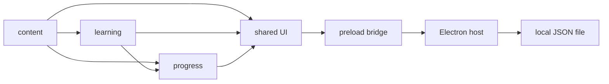

# Architecture

## Design principles

The core learning experience works without connectivity. Keep the game-domain logic deterministic and isolated from Electron and the DOM, so another platform host can reuse it. Avoid server-side infrastructure and premature extension points.

## Capability graph

Arrows in the diagram represent data/use relationships from the lower feature to the consumer, not package imports. In code: `learning -> content`, `progress -> content + learning`, `shared -> all domain modules`; `desktopApp` uses its own host APIs and only communicates through preload IPC, not direct imports of renderer implementation.

## Data flow

1. `content` supplies the full reference kana catalog, the unchanged first 14 stones, deterministic hash-based stone generation outside the first 16×10 area, and five ordered vowel templates.
2. `learning` contains pure movement, two-cell jumps over already-inspected stones, one-time binary stone discovery, deposit and ordered stroke-placement transitions.
3. `progress` parses both the new V2 exploration snapshots and the original V1 snapshots, validates generated stone identities and enforces resource conservation (carried + stored + completed strokes + in-progress strokes = discovered shards).
4. `shared` renders a 16×10 viewport centered on the player through CSS Grid; the anvil displays numbered, CSS/SVG-only outlined strokes. Search/deposit/placed-stroke interactions save before being considered committed. Movement/jumps remain in memory until the next saved interaction.
5. `desktopApp` persists exploration state to the existing `progress.exploration.v1.json` path under Electron `userData`. Legacy quiz data in `progress.v1.json` remains untouched. Browser preview has an independent localStorage namespace.

## Persistence and compatibility

New exploration payloads have `formatVersion: 2`, `mode: 'exploration'`, `player`, `inspectedStoneIds`, `carriedShards`, `storedShards`, `craftedKanaIds` and `assembly` (null or `{symbol, placedCount}`). Original V1 exploration saves are validated using the original fixed stone/cost semantics, then migrated in memory to V2; no write occurs merely on reading. The existing filename is retained so previous players can continue without manual file moves. Future/invalid saves fail visibly without mutation.

The saved list of inspected stones is bounded to 50,000 IDs, and host payloads to 1 MiB. The coordinate field is deterministic without storing generated chunks; if persistence size becomes a practical limit, a new chunk-based profile format will need its own active migration spec.

The Electron host uses a restricted, standard/secure `app://bundle` protocol rather than `file://` modules. Sandbox, context isolation, strict CSP, narrow preload calls, bounded IPC, and serialized atomic temporary-file-renamed writes remain in force. No runtime feature loads remote content.

## Future extension seams

`content` can later own educator-reviewed stroke geometry and additional recipes; `learning` can support freeform shard placement or navigation aids; `progress` can move to compact chunk storage through an explicitly versioned migration. The Desktop host must remain unaware of game rules.
